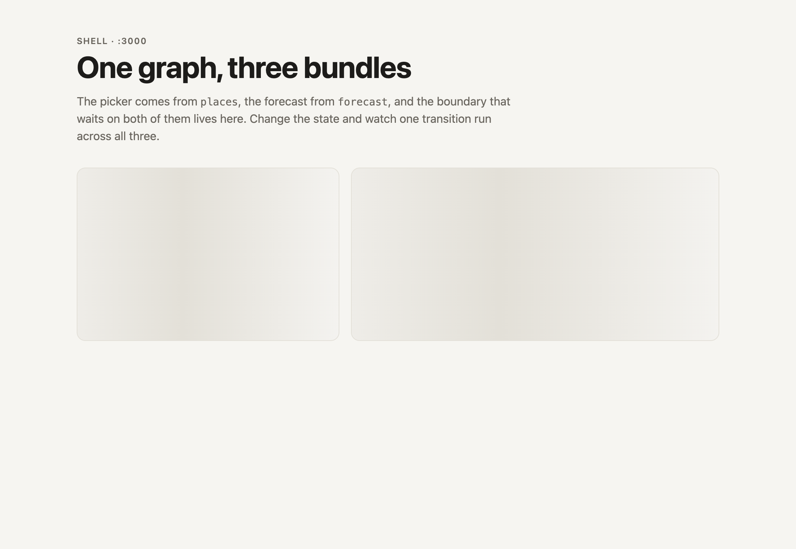
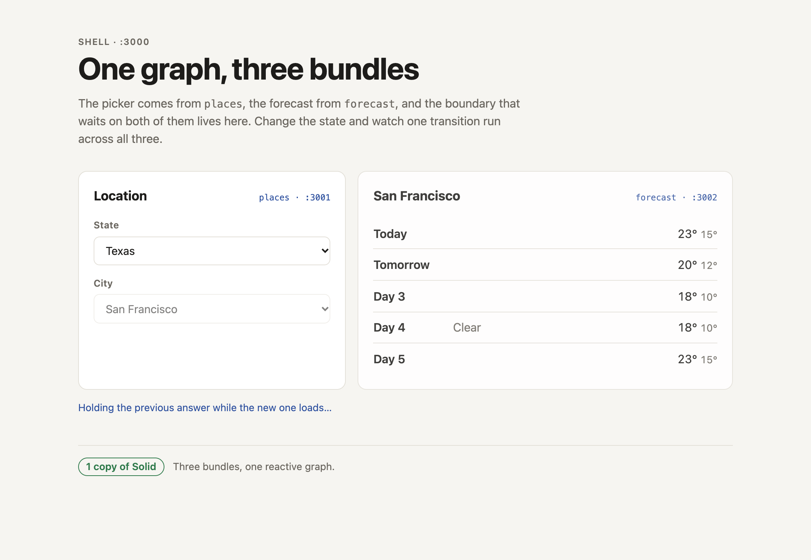

# This Solid 2.0 micro-frontend is broken

Three Rsbuild apps, wired together with Module Federation, running the async cascading dropdown from the [Solid 2.0 announcement](https://www.solidjs.com/blog/solid-2-0-the-long-hold/). Every component is correct. The page never loads.



```bash
pnpm install
pnpm dev   # shell on :3000, places on :3001, forecast on :3002
```

Open http://localhost:3000 and the skeleton stays up forever. The console says:

```
You appear to have multiple instances of Solid: a signal or store from one copy was read
inside a computation of another, so the read is not tracked and will not update.

[PENDING_ASYNC_UNTRACKED_READ] Reading a pending async value directly in <Forecast>.
Async values must be read within a tracking scope (JSX, a memo, or an effect's compute function).

[REACTIVITY_HALTED] An uncaught error halted the reactive system.
No further updates will be processed.
```

Solid's diagnostic points at `<Forecast>`. Go look at [`Forecast.tsx`](apps/forecast/src/Forecast.tsx). Its async memo is read inside JSX, which is a tracking scope. There's nothing to fix in that file.

## The apps

| App | Port | Role | What it owns |
| --- | --- | --- | --- |
| `shell` | 3000 | host | The page, the only `<Loading>` boundary, the context provider |
| `places` | 3001 | remote | `./location` (async memos, writable derived signals, a context) and `./LocationPicker` |
| `forecast` | 3002 | remote | `./Forecast`, which turns a plain `city` prop into an async memo |

Each remote also runs standalone on its own port, and both work fine on their own.

## Spoiler

<details>
<summary>What's wrong</summary>

[`apps/forecast/rsbuild.config.ts`](apps/forecast/rsbuild.config.ts) has no `shared` block. The shell and `places` both use the shared config in [`mf.shared.ts`](mf.shared.ts). `forecast` never imported it, so it bundles its own private copy of Solid.

Solid 2.0 keeps the scheduler, owner tree and transition state in module state inside `@solidjs/signals`. Two copies means two reactive graphs. `Forecast`'s memo belongs to the copy inside `forecast`, while the JSX reading it runs under an owner from the shell's copy. Neither copy sees a tracking scope, the pending read throws, the error escapes the shell's `<Loading>` because that boundary belongs to the other graph, and the whole app halts.

The fix is two lines, on the [`fix` branch](https://github.com/Nsttt/solid2-mf-broken/compare/main...fix):

```diff
-import { localCors } from '../../mf.shared';
+import { localCors, sharedSolid } from '../../mf.shared';
 ...
       exposes: {
         './Forecast': './src/Forecast.tsx',
       },
+      shared: sharedSolid,
```

And the shared config itself names three packages, not one:

```ts
const solid = { singleton: true, requiredVersion: '^2.0.0' } as const;

export const sharedSolid = {
  'solid-js': solid,
  '@solidjs/web': solid,
  '@solidjs/signals': solid,
};
```

`@solidjs/signals` is the one people miss. Solid 2.0 loads a subpath, `solid-js/internal`, that a plain `'solid-js'` key doesn't cover, and that subpath imports `@solidjs/signals` directly. Share only `solid-js`, the way most Solid 1.x federation setups did, and the page works. Transitions look right and the console is clean. The development-only counter on `globalThis.Solid$$copies` still reports three copies of the runtime, one per bundle.

After the fix, picking a new state holds the old screen across all three bundles and commits the new one at once:



</details>

## Stack

`solid-js@2.0.0`, `@solidjs/web@2.0.0`, `@rsbuild/core@2.3`, `@rsbuild/plugin-solid@2.0.0`, `@module-federation/rsbuild-plugin@2.9`. Data comes from fake APIs with fixed delays (500ms states, 700ms cities, 900ms forecast) so the loading states are long enough to see.
